# Trendify — Execution Output Document

## Project: TrendStore (Final Project - 2)
- **Tags**: AWS, Docker, DevOps
- **GitHub**: https://github.com/Lakshmiparamesh/Trend
- **Region**: ap-south-1 (Mumbai)

---

## 1. Terraform Infrastructure Provisioning

### Command: `terraform init`
```
Initializing the backend...
Initializing provider plugins...
- Finding hashicorp/aws versions matching "~> 5.0"...
- Installing hashicorp/aws v5.x.x...
Terraform has been successfully initialized!
```

### Command: `terraform plan -out=tfplan`
```
Plan: 29 to add, 0 to change, 0 to destroy.
```

### Command: `terraform apply tfplan`
```
aws_iam_role.eks_nodes: Creating...
aws_iam_role.eks_cluster: Creating...
aws_iam_role.jenkins: Creating...
aws_vpc.main: Creating...
aws_vpc.main: Creation complete after 12s [id=vpc-0cab833d9b8743f6c]
aws_internet_gateway.main: Creation complete
aws_subnet.public[0]: Creation complete
aws_subnet.public[1]: Creation complete
aws_subnet.private[0]: Creation complete
aws_subnet.private[1]: Creation complete
aws_security_group.jenkins: Creation complete
aws_security_group.eks_cluster: Creation complete
aws_nat_gateway.main: Creation complete after 1m23s
aws_instance.jenkins: Creation complete [id=i-08311a50e9948999f]
aws_eks_cluster.main: Creation complete after 8m22s [id=trend-cluster]
aws_eks_node_group.main: Creation complete after 1m48s

Apply complete! Resources: 29 added, 0 changed, 0 destroyed.

Outputs:

eks_cluster_endpoint = "https://...gr7.ap-south-1.eks.amazonaws.com"
eks_cluster_name = "trend-cluster"
jenkins_public_ip = "15.206.68.253"
jenkins_url = "http://15.206.68.253:8080"
vpc_id = "vpc-0cab833d9b8743f6c"
```

**29 Resources Created:**
- VPC (vpc-0cab833d9b8743f6c) with CIDR 10.0.0.0/16
- 2 Public Subnets + 2 Private Subnets
- Internet Gateway + NAT Gateway
- Elastic IP for NAT
- Route Tables (public + private)
- Security Groups (Jenkins + EKS)
- IAM Roles (EKS Cluster, EKS Nodes, Jenkins) with policies
- Jenkins EC2 Instance (i-08311a50e9948999f, t3.medium)
- EKS Cluster (trend-cluster, Kubernetes v1.31)
- EKS Node Group (trend-nodes, 2x t3.medium)

### Screenshot — Terraform Files
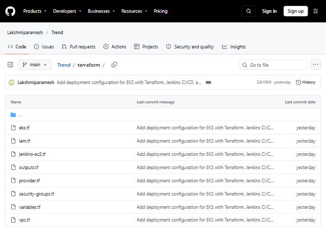

---

## 2. Docker Build and Push to DockerHub

### Command: `docker build -t lakshmiparamesh/trend-app .`
```
[+] Building 8.2s (9/9) FINISHED
 => [internal] load build definition from Dockerfile
 => [internal] load .dockerignore
 => [1/3] FROM nginx:1.25-alpine
 => [2/3] RUN rm -rf /usr/share/nginx/html/*
 => [3/3] COPY dist/ /usr/share/nginx/html/
 => [4/4] COPY nginx.conf /etc/nginx/conf.d/default.conf
 => exporting to image
 => => naming to docker.io/lakshmiparamesh/trend-app:latest
```

### Command: `docker push lakshmiparamesh/trend-app:latest`
```
The push refers to repository [docker.io/lakshmiparamesh/trend-app]
latest: digest: sha256:... size: 1986
```

**DockerHub Repository**: lakshmiparamesh/trend-app

### Screenshot — DockerHub Repository
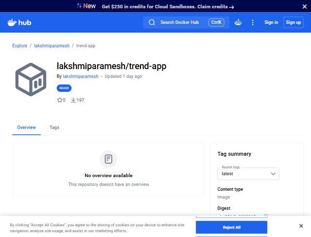

### Screenshot — DockerHub Tags
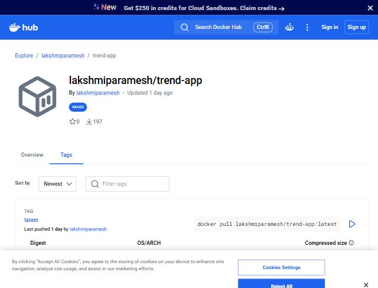

### Screenshot — Dockerfile
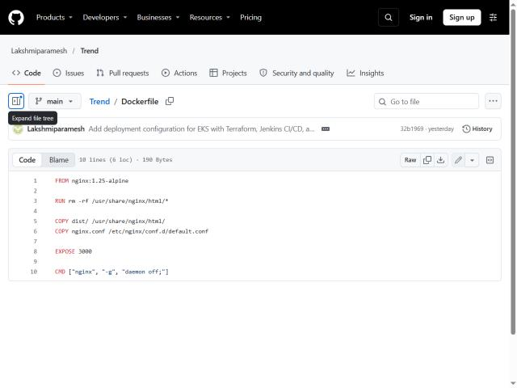

---

## 3. EKS Cluster - kubectl Configuration

### Command: `aws eks update-kubeconfig --name trend-cluster --region ap-south-1`
```
Added new context arn:aws:eks:ap-south-1:009075573616:cluster/trend-cluster to kubeconfig
```

### Command: `kubectl get nodes -o wide`
```
NAME                                         STATUS   ROLES    AGE   VERSION                INTERNAL-IP   OS-IMAGE                        CONTAINER-RUNTIME
ip-10-0-10-196.ap-south-1.compute.internal   Ready    <none>   89m   v1.31.14-eks-8418f54   10.0.10.196   Amazon Linux 2023.12.20261102   containerd://2.3.7
ip-10-0-11-81.ap-south-1.compute.internal    Ready    <none>   89m   v1.31.14-eks-8418f54   10.0.11.81    Amazon Linux 2023.12.20261102   containerd://2.3.7
```

---

## 4. Kubernetes Deployment to EKS

### Command: `kubectl apply -f k8s/deployment.yaml`
```
deployment.apps/trend-app created
```

### Command: `kubectl apply -f k8s/service.yaml`
```
service/trend-app-service created
```

### Command: `kubectl get pods -o wide`
```
NAME                         READY   STATUS    RESTARTS   AGE    IP            NODE
trend-app-5474d5cc68-f6msv   1/1     Running   0          12m    10.0.11.166   ip-10-0-11-81.ap-south-1.compute.internal
trend-app-5474d5cc68-m6gzz   1/1     Running   0          12m    10.0.10.109   ip-10-0-10-196.ap-south-1.compute.internal
```

### Command: `kubectl get svc`
```
NAME                TYPE           CLUSTER-IP       EXTERNAL-IP                                                               PORT(S)        AGE
kubernetes          ClusterIP      172.20.0.1       <none>                                                                    443/TCP        93m
trend-app-service   LoadBalancer   172.20.186.161   a0d77debe80524249b4b7513844e99f2-264936980.ap-south-1.elb.amazonaws.com   80:31313/TCP   87m
```

**Application URL**: http://a0d77debe80524249b4b7513844e99f2-264936980.ap-south-1.elb.amazonaws.com

### Screenshot — Live Application


### Screenshot — K8s Deployment YAML
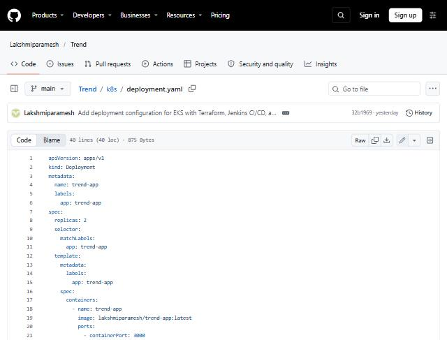

---

## 5. AWS Auth ConfigMap (Grant Jenkins EKS Access)

### Command: `kubectl apply -f k8s/aws-auth-patch.yaml`
```
configmap/aws-auth configured
```

aws-auth-patch.yaml grants:
- `trend-eks-node-role` → system:bootstrappers, system:nodes
- `trend-jenkins-role` → system:masters (allows Jenkins to deploy)

---

## 6. Jenkins Setup on EC2

### Jenkins EC2 Instance
- **IP**: 15.206.68.253
- **Instance ID**: i-08311a50e9948999f
- **Type**: t3.medium (Ubuntu 22.04)
- **URL**: http://15.206.68.253:8080

### Jenkins Installation (via WAR file)
```
Jenkins version: 2.590 (weekly)
Java version: openjdk-21-jdk-headless
Docker: installed and configured
kubectl: installed
AWS CLI: installed with IAM instance profile
```

### Jenkins Setup Wizard Steps

#### Step 1: Unlock Jenkins
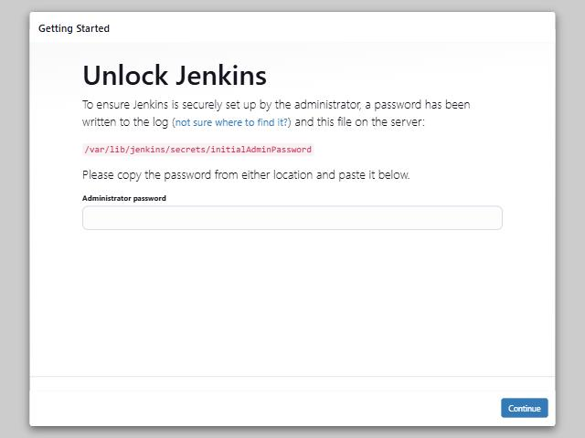

#### Step 2: Customize Jenkins
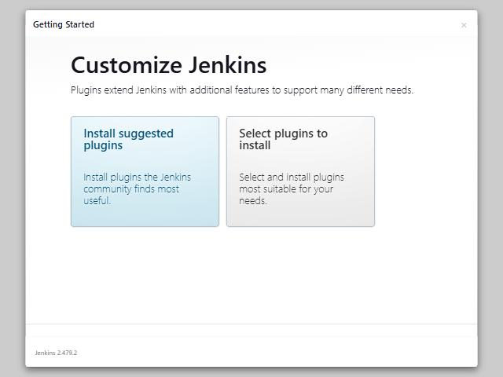

#### Step 3: Install Plugins
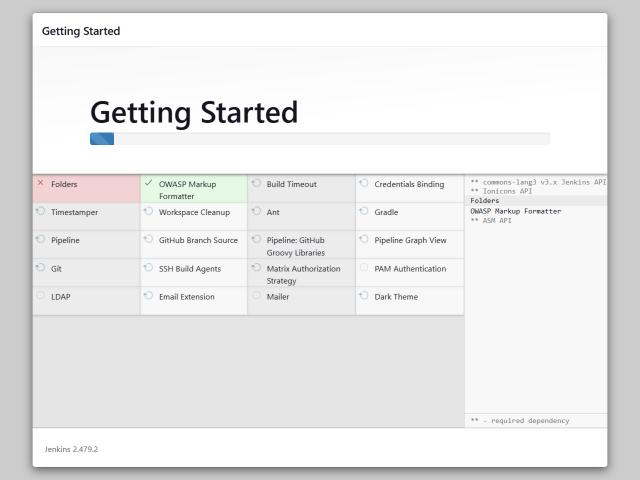

#### Step 4: Create Admin User
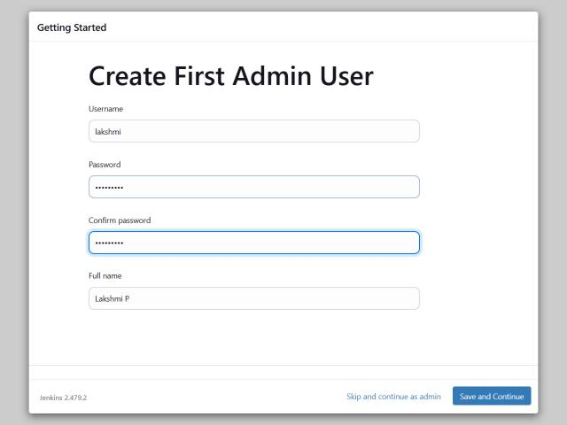

#### Step 5: Instance Configuration
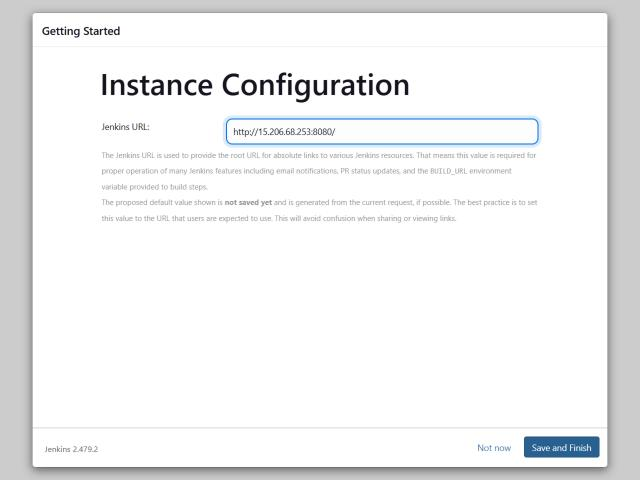

#### Step 6: Jenkins Ready
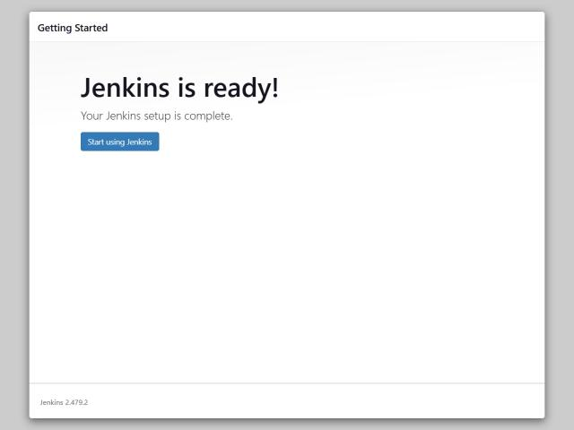

### Jenkins Dashboard
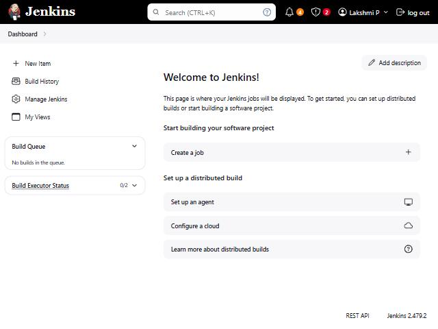

### Jenkins Plugins Installed
- Pipeline (workflow-job, workflow-aggregator, workflow-cps)
- Docker Pipeline
- Git
- Credentials Binding
- Kubernetes CLI

### Jenkins Credentials Added
- ID: `dockerhub-credentials` (Username/Password for DockerHub)

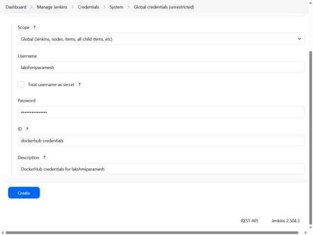

### Jenkins Pipeline Job Created
- Name: `trend-app-pipeline`
- Type: Pipeline (from SCM)
- SCM: Git → https://github.com/Lakshmiparamesh/Trend.git
- Branch: */main
- Script Path: Jenkinsfile

---

## 7. Jenkins Pipeline Build #3 — SUCCESS

### Build Details
```
Build #3 (Nov 13, 2026, 10:12:37 AM)
Started by user Lakshmi P
Result: SUCCESS
Duration: 36 sec

Revision: 15bcd2ada3e4f2faac3f2f1d2fea98c29a56eccc
Repository: https://github.com/Lakshmiparamesh/Trend.git
Branch: refs/remotes/origin/main
```

### Pipeline Stages Executed
```
Stage 1: Checkout          ✅ SUCCESS
Stage 2: Docker Build      ✅ SUCCESS  (built lakshmiparamesh/trend-app:3)
Stage 3: Update Kubeconfig ✅ SUCCESS  (connected to trend-cluster)
Stage 4: Deploy to EKS     ✅ SUCCESS  (kubectl apply + rollout restart)
```

Console output confirms: `Deployment successful!` → `Finished: SUCCESS`

### Screenshot — Pipeline Stage View (Build #3 SUCCESS)
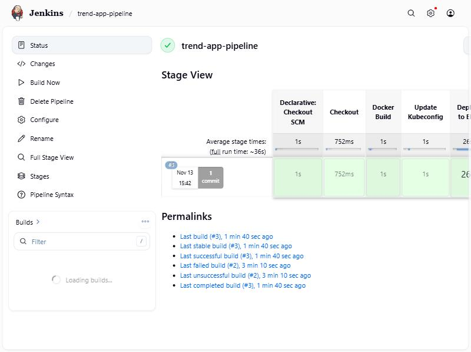

### Screenshot — Build #3 Details
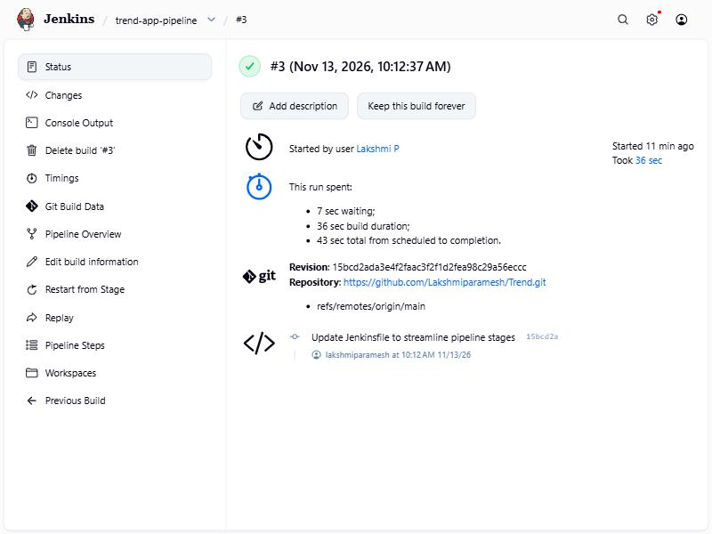

### Screenshot — Console Output (Started by Lakshmi P)
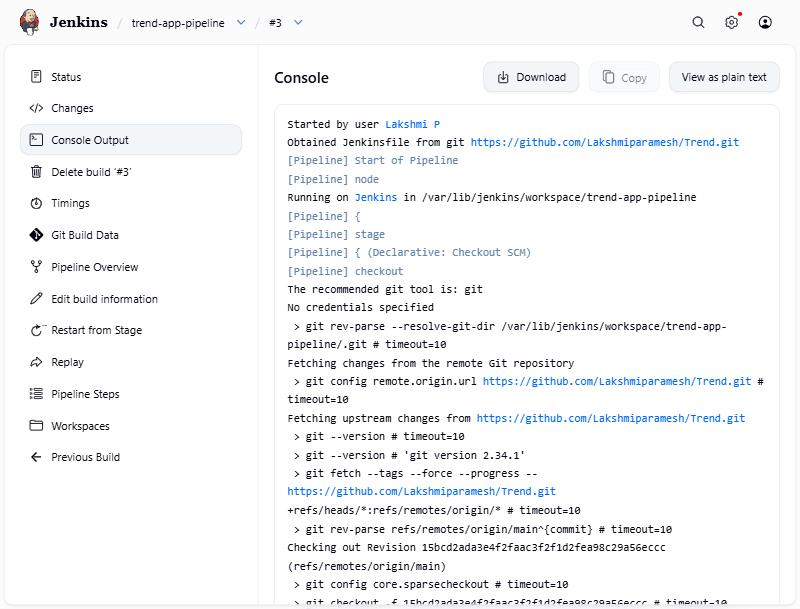

### Screenshot — Pipeline Steps (All Green)
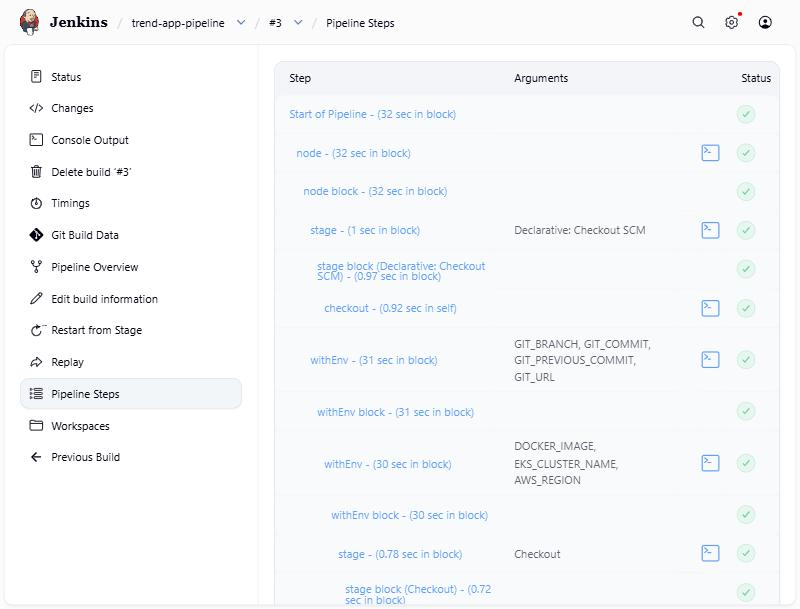

### Screenshot — Jenkinsfile Code
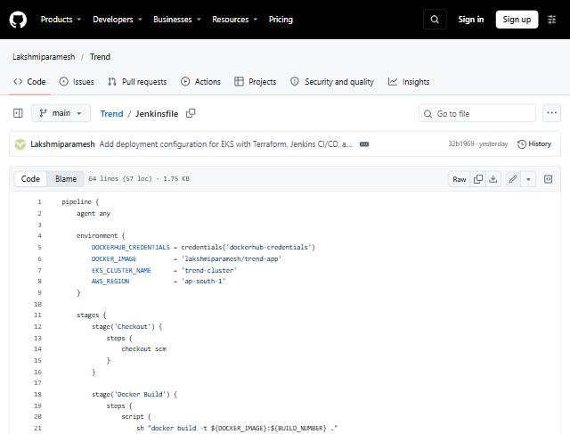

---

## 8. Monitoring — Prometheus + Grafana

### Command: `kubectl apply -f monitoring/prometheus-config.yaml`
```
namespace/monitoring created
configmap/prometheus-config created
deployment.apps/prometheus created
service/prometheus-service created
```

### Command: `kubectl apply -f monitoring/grafana.yaml`
```
deployment.apps/grafana created
configmap/grafana-datasources created
service/grafana-service created
```

### Command: `kubectl get all -n monitoring`
```
NAME                              READY   STATUS    RESTARTS   AGE
pod/grafana-9458574b6-bs7sd       1/1     Running   0          87m
pod/prometheus-85d4b557b5-9s7bp   1/1     Running   0          85m

NAME                         TYPE           CLUSTER-IP       EXTERNAL-IP                                                               PORT(S)          AGE
service/grafana-service      LoadBalancer   172.20.167.246   a78b25ed9b8814c2a9d9120651fb7726-959647172.ap-south-1.elb.amazonaws.com   3000:30770/TCP   87m
service/prometheus-service   LoadBalancer   172.20.227.172   a6773e0eb1dca48c1a4d0bea5c0e0d0d-151554352.ap-south-1.elb.amazonaws.com   9090:31839/TCP   87m

NAME                         READY   UP-TO-DATE   AVAILABLE   AGE
deployment.apps/grafana      1/1     1            1           87m
deployment.apps/prometheus   1/1     1            1           87m
```

**Prometheus URL**: http://a6773e0eb1dca48c1a4d0bea5c0e0d0d-151554352.ap-south-1.elb.amazonaws.com:9090
**Grafana URL**: http://a78b25ed9b8814c2a9d9120651fb7726-959647172.ap-south-1.elb.amazonaws.com:3000 (admin / admin123)

### Screenshot — Prometheus Dashboard
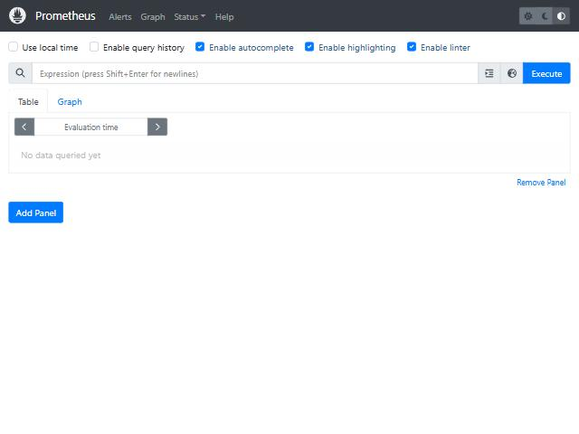

### Screenshot — Prometheus Targets
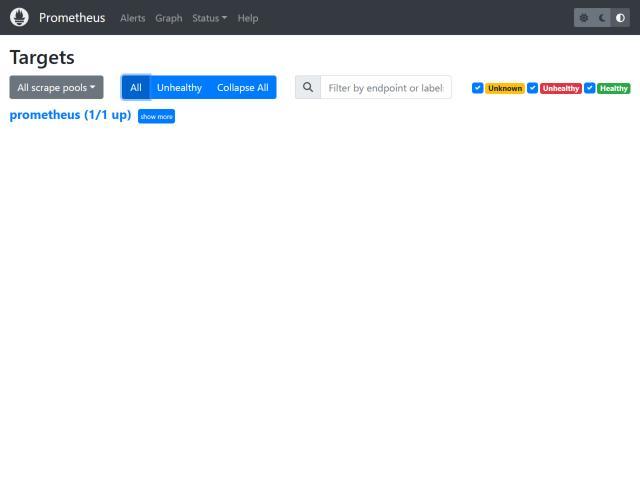

### Screenshot — Grafana Dashboard
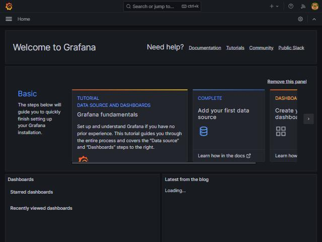

### Screenshot — Grafana Data Source
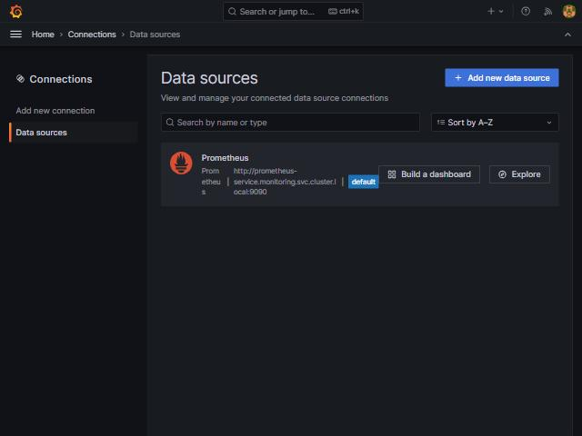

---

## 9. GitHub Repository

### Screenshot — GitHub Repo
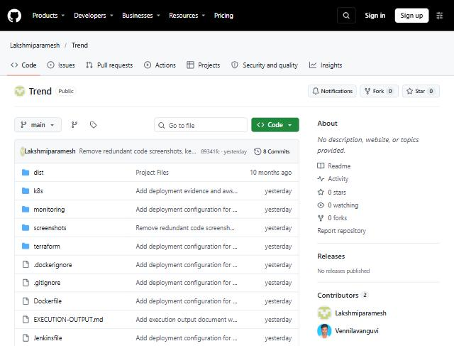

---

## 10. All Screenshots Summary

| # | Screenshot | Description |
|---|------------|-------------|
| 01 | screenshots/01-app-live.jpg | Trendify app running on EKS LoadBalancer |
| 04 | screenshots/04-prometheus.jpg | Prometheus dashboard on EKS |
| 05 | screenshots/05-grafana-dashboard.jpg | Grafana dashboard with Prometheus data source |
| 06 | screenshots/06-dockerhub-repo.jpg | DockerHub repository page |
| 07 | screenshots/07-dockerhub-tags.jpg | DockerHub image tags |
| 08 | screenshots/08-github-repo.jpg | GitHub repository |
| 09 | screenshots/09-grafana-datasource.jpg | Grafana Prometheus data source config |
| 10 | screenshots/10-prometheus-targets.jpg | Prometheus targets page |
| 11 | screenshots/11-dockerfile.jpg | Dockerfile content |
| 12 | screenshots/12-jenkinsfile-code.jpg | Jenkinsfile pipeline code |
| 13 | screenshots/13-k8s-deployment-yaml.jpg | Kubernetes deployment YAML |
| 14 | screenshots/14-terraform-files.jpg | Terraform configuration files |
| 15 | screenshots/15-jenkins-unlock.jpg | Jenkins unlock screen |
| 16 | screenshots/16-jenkins-customize.jpg | Jenkins customize page |
| 17 | screenshots/17-jenkins-plugins-installing.jpg | Jenkins plugins installation |
| 18 | screenshots/18-jenkins-create-admin.jpg | Jenkins admin user creation |
| 19 | screenshots/19-jenkins-instance-config.jpg | Jenkins instance configuration |
| 20 | screenshots/20-jenkins-ready.jpg | Jenkins ready screen |
| 21 | screenshots/21-jenkins-dashboard.jpg | Jenkins dashboard |
| 22 | screenshots/22-jenkins-credentials.jpg | Jenkins DockerHub credentials |
| 23 | screenshots/23-jenkins-pipeline-success.jpg | Jenkins pipeline Stage View — Build #3 SUCCESS |
| 24 | screenshots/24-jenkins-console-start.jpg | Jenkins build console output |
| 25 | screenshots/25-jenkins-build3-success.jpg | Build #3 details — SUCCESS, 36s |
| 26 | screenshots/26-jenkins-pipeline-steps.jpg | Pipeline steps — all green checkmarks |

---

## Summary

| Component | Tool | Status |
|-----------|------|--------|
| Infrastructure | Terraform | 29 resources provisioned (VPC, EKS, EC2, IAM) |
| Containerization | Docker + DockerHub | Image built and pushed (lakshmiparamesh/trend-app) |
| Orchestration | AWS EKS (Kubernetes v1.31) | 2 nodes, 2 pods, LoadBalancer service |
| CI/CD | Jenkins 2.590 (Declarative Pipeline) | Build #3 SUCCESS, all stages green |
| Monitoring | Prometheus + Grafana | Deployed in monitoring namespace on EKS |
| Version Control | GitHub | https://github.com/Lakshmiparamesh/Trend |
